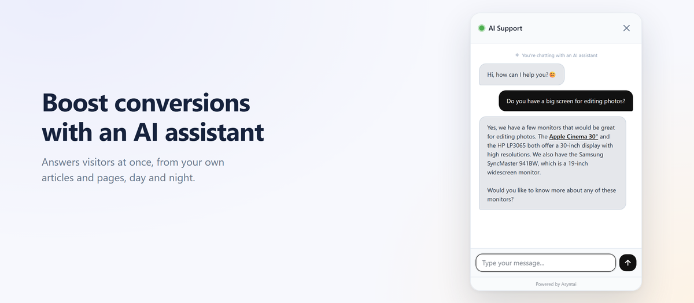
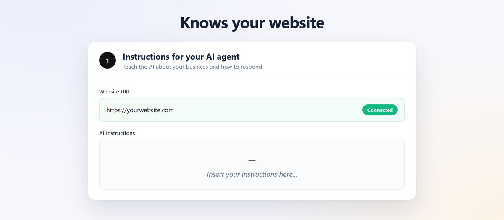
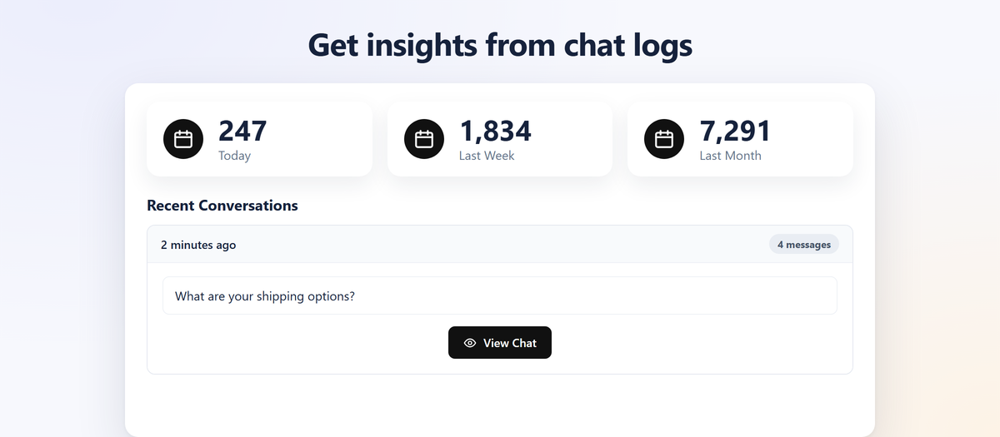
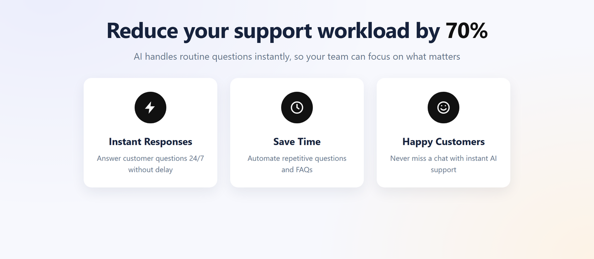
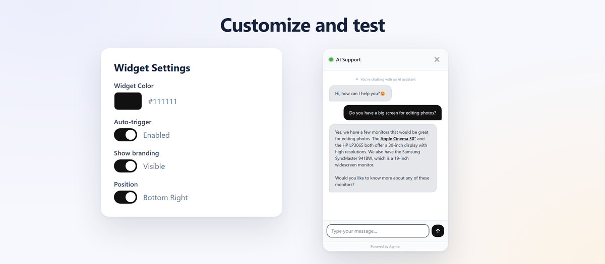

# Asyntai - AI Chatbot

AI assistant / chatbot plugin for Craft CMS – Provides instant answers to your website visitors.

## Description

Asyntai adds an AI chatbot to your Craft CMS site. It provides instant answers to visitors according to your instructions/knowledge base.

- **Always up to date**: Share your published entries with the chatbot directly, so its answers follow every change you make.
- **Works in all languages**: Automatically detects and answers in the visitor's language.
- **Never miss a chat**: The AI replies day and night, even when your team is offline.

## Requirements

- Craft CMS 3.7 or later (supports Craft 3, 4, and 5)
- PHP 7.2.5 or later

## Installation

### Method 1: Plugin Store (Recommended)

1. In the Craft Control Panel, go to **Plugin Store**
2. Search for "Asyntai" and click **Install**

### Method 2: Composer

```bash
composer require asyntai/craft-chatbot
php craft plugin/install asyntai
```

## Setup

1. After installation, go to **Asyntai AI Chatbot** in the Control Panel menu
2. Leave "Let the chatbot read my published pages directly" ticked to share your pages with the chatbot
3. Click the **Get started** button to create a free Asyntai account or sign in
4. The popup will connect your site automatically
5. Once connected, the chatbot will appear on all pages of your site

## Configuration

After connecting your account, you can:

- **Manage chatbot settings**: Visit [Asyntai Dashboard](https://asyntai.com/dashboard)
- **Customize AI responses**: Go to [Setup page](https://asyntai.com/dashboard#setup)
- **View chat logs**: Available in your Asyntai panel
- **Page sharing**: Switch it on or off at any time on the plugin page

## External Services

This plugin connects to Asyntai.com to enable and operate the chatbot widget. The Asyntai service hosts the chatbot application and processes chats so your visitors can interact with the AI assistant on your site.

To complete the plugin setup, you need to create an account or log in to your existing Asyntai account (via asyntai.com). The external service is required to deliver the chatbot experience, process messages, and manage settings and logs.

When page sharing is on, Asyntai reads the live entries of your primary site that have their own page, through a signed address on your site. Only published entries that any visitor can already see are shared.

See Asyntai's [Terms of Service](https://asyntai.com/terms-and-conditions/) and [Privacy Policy](https://asyntai.com/privacy-policy/).

## Support

For support, please visit [asyntai.com/contact](https://asyntai.com/contact)

## License

MIT License - see LICENSE file for details






